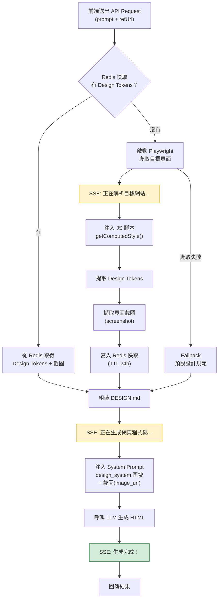

# 自動化 UI 視覺解析與 DESIGN.md 即時生成 — 實作計畫 (v2)

## 1. 決策確認

| 項目 | 決策 |
|------|------|
| Playwright 安裝位置 | ✅ 直接安裝在 `admin-app` 容器內 |
| 頁面截圖傳給 LLM | ✅ 爬取時同時截圖，傳給有圖片辨識的模型（Gemini / GPT） |
| 靜態品牌資料庫 | ❌ 暫不建立，全部走動態爬取 + 快取 |
| 前端進度回饋 | ✅ 改為分段進度提示（SSE 方案） |

---

## 2. 系統架構



---

## 3. 具體檔案變更

### 3.1 基礎設施層

---

#### [MODIFY] [Dockerfile](file:///home/mike/projects/fake_login/adminapp/Dockerfile)

目前使用 `python:3.12-slim`，需新增 Playwright + Chromium 安裝步驟：

```dockerfile
FROM python:3.12-slim

ENV PYTHONDONTWRITEBYTECODE=1 \
    PYTHONUNBUFFERED=1

WORKDIR /app

# 安裝 Playwright 系統依賴（在 pip install 之前）
RUN apt-get update && apt-get install -y --no-install-recommends \
    libnss3 libatk1.0-0 libatk-bridge2.0-0 libcups2 \
    libdrm2 libxkbcommon0 libxcomposite1 libxdamage1 \
    libxrandr2 libgbm1 libpango-1.0-0 libcairo2 \
    libasound2 libxshmfence1 fonts-noto-cjk \
    && rm -rf /var/lib/apt/lists/*

COPY requirements.txt .
RUN pip install --no-cache-dir --upgrade pip \
    && pip install --no-cache-dir -r requirements.txt \
    && playwright install chromium

# ... 其餘不變
```

> [!WARNING]
> **Image 體積影響**：安裝 Chromium 會使 Image 增加約 400-600MB。
> `fonts-noto-cjk` 是為了讓截圖中正確顯示中日韓文字。
> 需要移除 `adduser` 後的 `USER appuser` 行，或在 root 階段先安裝好 Playwright。

#### [MODIFY] [requirements.txt](file:///home/mike/projects/fake_login/adminapp/requirements.txt)

新增一行：
```
playwright
```

---

### 3.2 後端新增模組

---

#### [NEW] `backend/services/design_extractor.py`

**職責**：使用 Playwright async API 爬取目標網站，提取 Design Tokens 並擷取截圖。

核心函式：

```python
async def extract_design_tokens(url: str) -> dict | None:
    """
    啟動 headless Chromium，前往 URL，提取設計 tokens 並截圖。
    
    回傳結構：
    {
        "url": "https://...",
        "domain": "accounts.google.com",
        "typography": {
            "font_family": "Roboto, sans-serif",
            "heading_font": "Google Sans, sans-serif"
        },
        "colors": {
            "background": "#ffffff",
            "text_primary": "#202124",
            "primary_action": "#1a73e8",
            "primary_action_text": "#ffffff",
            "input_border": "#dadce0",
            "input_border_focus": "#1a73e8"
        },
        "components": {
            "button": {
                "border_radius": "4px",
                "box_shadow": "none",
                "padding": "0 24px",
                "font_weight": "500",
                "font_size": "14px"
            },
            "input": {
                "border_radius": "4px",
                "border_width": "1px",
                "padding": "13px 15px",
                "font_size": "16px"
            },
            "card": {
                "border_radius": "8px",
                "box_shadow": "0 2px 6px rgba(0,0,0,.2)",
                "padding": "48px 40px"
            }
        },
        "screenshot_base64": "data:image/png;base64,..."
    }
    """
```

**注入的 JavaScript 腳本**邏輯：
1. 尋找 `body` 元素 → 讀取 `background-color`, `font-family`, `color`
2. 尋找第一個 `<button>` 或 `[type="submit"]` → 讀取 `background-color`, `border-radius`, `box-shadow`, `padding`
3. 尋找第一個 `<input>` → 讀取 `border-radius`, `border-color`, `padding`
4. 尋找主要容器（`form`, `.card`, `[role="main"]`）→ 讀取 `border-radius`, `box-shadow`
5. 尋找 `<h1>` 或 `<h2>` → 讀取 `font-family`（辨別 heading 字體）

**截圖**：使用 `page.screenshot(full_page=False, type='png')` 擷取可視區域截圖，轉為 base64。

**超時與容錯**：
- 全流程超時 15 秒
- 任何異常 return `None`

---

#### [NEW] `backend/services/design_generator.py`

**職責**：將 Design Tokens JSON 組裝為 DESIGN.md Markdown 文字。

核心函式：

```python
def generate_design_md(tokens: dict) -> str:
    """將 Design Tokens 組裝成 DESIGN.md 格式（Google Stitch 九段式結構）"""
    
def get_fallback_design_md() -> str:
    """爬取失敗時的預設設計規範"""

async def get_design_context(url: str, progress_callback=None) -> dict:
    """
    主入口：帶快取的設計上下文獲取。
    
    回傳：
    {
        "design_md": str,         # DESIGN.md Markdown 文字
        "screenshot_b64": str,    # 截圖 base64（可能為 None）
        "source": "cache" | "live" | "fallback"
    }
    """
```

**DESIGN.md 模板**（遵循 Google Stitch 標準格式）：

```markdown
# {domain} — Extracted Design System

## Visual Theme & Atmosphere
Clean, professional interface. Extracted from live site analysis.

## Color Palette & Roles
| Role | Hex | Usage |
|------|-----|-------|
| Background | {bg} | 頁面主背景色 |
| Text Primary | {text} | 主要文字色 |
| Primary Action | {action} | CTA 按鈕背景色 |

## Typography Rules
- **Body Font:** `{font_family}`
- **Heading Font:** `{heading_font}`

## Component Stylings

### Buttons
- Border Radius: `{btn_radius}`
- Box Shadow: `{btn_shadow}`
- Padding: `{btn_padding}`
- Font Weight: `{btn_weight}`

### Input Fields
- Border Radius: `{input_radius}`
- Border Color: `{input_border}`
- Padding: `{input_padding}`

### Cards / Containers
- Border Radius: `{card_radius}`
- Box Shadow: `{card_shadow}`

## Do's and Don'ts
- ✅ 使用以上精確的 Hex 色碼
- ✅ 嚴格遵循圓角數值
- ❌ 不可使用相近但不同的色碼替代
- ❌ 不可自行添加未在規範中的陰影效果
```

---

#### [NEW] `backend/services/design_cache.py`

**職責**：Redis 快取管控。

```python
# Key 格式：design_tokens:{domain_hash}
# TTL：24 小時
# 儲存內容：JSON（包含 tokens + screenshot_base64 + design_md）

async def get_cached_design(url: str) -> dict | None
async def set_cached_design(url: str, data: dict) -> None
def url_to_cache_key(url: str) -> str
```

---

### 3.3 API 整合（核心修改）

---

#### [MODIFY] [trigger_page_api.py](file:///home/mike/projects/fake_login/adminapp/backend/api/trigger_page_api.py)

##### 3.3.1 新增 SSE 生成端點

新增一個統一的 SSE 端點 `POST /generate_with_ai_stream`，替代（或並存）現有三個端點：

```python
from fastapi.responses import StreamingResponse

@router.post(
    "/generate_with_ai_stream",
    summary="使用 AI 生成頁面（SSE 串流進度）",
    tags=["trigger page"]
)
async def generate_page_with_ai_stream(
    prompt: str = Form(...),
    refUrl: str = Form(None),
    image: UploadFile = File(None),
    pageType: str = Form("field"),
    aiModel: str = Form("gemini"),
    current_user: dict = Depends(get_current_user)
):
    async def event_generator():
        # 階段 1：設計解析
        if refUrl:
            yield sse_event("progress", {
                "stage": "extracting", 
                "message": "正在解析目標網站設計風格..."
            })
            design_context = await get_design_context(refUrl)
            yield sse_event("progress", {
                "stage": "extracted",
                "message": f"設計解析完成（來源：{design_context['source']}）",
                "source": design_context["source"]
            })
        
        # 階段 2：LLM 生成
        yield sse_event("progress", {
            "stage": "generating",
            "message": "正在使用 AI 生成網頁程式碼..."
        })
        
        # 組合 System Prompt + design_md
        system_instructions = get_system_prompt(pageType)
        if refUrl and design_context.get("design_md"):
            system_instructions += f"\n\n<design_system>\n{design_context['design_md']}\n</design_system>"
            system_instructions += "\n\n[嚴格要求] 你必須完全遵守上方 <design_system> 中的設計規範。"
        
        # 根據 aiModel 選擇 client 並呼叫
        html_content = await call_llm(
            model=aiModel,
            system_instructions=system_instructions,
            user_prompt=prompt,
            ref_url=refUrl,
            image=image,
            screenshot_b64=design_context.get("screenshot_b64") if refUrl else None
        )
        
        # 階段 3：完成
        yield sse_event("complete", {
            "stage": "done",
            "message": "生成完成！",
            "html": html_content
        })
    
    return StreamingResponse(
        event_generator(),
        media_type="text/event-stream",
        headers={
            "Cache-Control": "no-cache",
            "Connection": "keep-alive",
            "X-Accel-Buffering": "no"  # Nginx 不要 buffer
        }
    )
```

##### 3.3.2 重構共用 LLM 呼叫

將三個端點的重複程式碼抽取成統一函式：

```python
async def call_llm(
    model: str,           # "gemini" | "gpt" | "litellm"
    system_instructions: str,
    user_prompt: str,
    ref_url: str = None,
    image: UploadFile = None,
    screenshot_b64: str = None
) -> str:
    """統一的 LLM 呼叫函式"""
```

**截圖注入邏輯**：
- 若有 `screenshot_b64`，且模型支援多模態（Gemini / GPT），將截圖作為額外的 `image_url` 傳入 user message
- LiteLLM (gemma-27b) 不支援圖片辨識，跳過截圖

##### 3.3.3 保留原有端點

原有三個端點（`generate_with_gemini` / `generate_with_gpt` / `generate_with_litellm`）**保留不動**作為向下相容，新增 SSE 端點作為主力使用。

---

### 3.4 Nginx 設定

---

#### [MODIFY] [nginx.conf](file:///home/mike/projects/fake_login/nginx/nginx.conf)

需要確保 Nginx 不會 buffer SSE 串流：

```nginx
location /api/trigger_page/generate_with_ai_stream {
    proxy_pass http://admin-app:8080;
    proxy_set_header Connection '';
    proxy_http_version 1.1;
    chunked_transfer_encoding off;
    proxy_buffering off;
    proxy_cache off;
}
```

> [!IMPORTANT]
> 如果現有 Nginx 已經有統一的 `/api/` 代理規則，可能只需要加上 `X-Accel-Buffering: no` header（已在 FastAPI 回應中設定），或者在 location 區塊加上 `proxy_buffering off;`。

---

### 3.5 前端修改

---

#### [MODIFY] [CreateUrl.jsx](file:///home/mike/projects/fake_login/adminapp/frontend/src/app/views/qrcode/CreateUrl.jsx)

##### 3.5.1 新增進度狀態

```javascript
// 新增 State（約 line 82 附近）
const [aiProgress, setAiProgress] = useState(null);
// aiProgress 結構：{ stage: 'extracting'|'extracted'|'generating'|'done', message: '...' }
```

##### 3.5.2 修改 `handleGenerateWithAi` 函式

從原本的 `fetch` + `response.text()` 改為 **SSE EventSource** 模式：

```javascript
const handleGenerateWithAi = async () => {
    if (!aiPrompt) {
        enqueueSnackbar('請輸入提示詞 (Prompt)', { variant: 'warning' });
        return;
    }

    setGenerating(true);
    setAiProgress({ stage: 'starting', message: '準備中...' });
    
    const formData = new FormData();
    formData.append('prompt', aiPrompt);
    formData.append('pageType', aiPageType);
    formData.append('aiModel', aiModel);
    if (aiRefUrl) formData.append('refUrl', aiRefUrl);
    if (aiImage) formData.append('image', aiImage);

    abortControllerRef.current = new AbortController();

    try {
        const accessToken = window.localStorage.getItem("accessToken");
        const response = await fetch('/api/trigger_page/generate_with_ai_stream', {
            method: 'POST',
            headers: { 'Authorization': `Bearer ${accessToken}` },
            body: formData,
            signal: abortControllerRef.current.signal
        });

        const reader = response.body.getReader();
        const decoder = new TextDecoder();
        let buffer = '';

        while (true) {
            const { done, value } = await reader.read();
            if (done) break;
            
            buffer += decoder.decode(value, { stream: true });
            const lines = buffer.split('\n\n');
            buffer = lines.pop(); // 保留不完整的部分
            
            for (const line of lines) {
                if (line.startsWith('data: ')) {
                    const data = JSON.parse(line.slice(6));
                    
                    if (data.type === 'progress') {
                        setAiProgress(data.data);
                    } else if (data.type === 'complete') {
                        // 生成完成，處理 HTML
                        const htmlContent = data.data.html;
                        // ... 後續邏輯同原本
                    } else if (data.type === 'error') {
                        throw new Error(data.data.message);
                    }
                }
            }
        }
    } catch (err) {
        // ... 錯誤處理同原本
    } finally {
        setGenerating(false);
        setAiProgress(null);
        abortControllerRef.current = null;
    }
};
```

##### 3.5.3 修改 AI Dialog 的進度 UI

在 `DialogContent` 中，`generating` 為 `true` 時顯示分段進度指示器：

```jsx
{generating && aiProgress && (
    <Box sx={{ mt: 2 }}>
        <Stepper 
            activeStep={
                aiProgress.stage === 'extracting' ? 0 :
                aiProgress.stage === 'extracted' ? 1 :
                aiProgress.stage === 'generating' ? 1 :
                aiProgress.stage === 'done' ? 2 : 0
            }
            alternativeLabel
        >
            <Step completed={['extracted','generating','done'].includes(aiProgress.stage)}>
                <StepLabel>解析目標網站</StepLabel>
            </Step>
            <Step completed={['done'].includes(aiProgress.stage)}>
                <StepLabel>AI 生成頁面</StepLabel>
            </Step>
            <Step completed={aiProgress.stage === 'done'}>
                <StepLabel>完成</StepLabel>
            </Step>
        </Stepper>
        
        <Box sx={{ display: 'flex', alignItems: 'center', mt: 2, gap: 1 }}>
            {aiProgress.stage !== 'done' && <CircularProgress size={20} />}
            <Typography variant="body2" color="text.secondary">
                {aiProgress.message}
            </Typography>
        </Box>
    </Box>
)}
```

> [!NOTE]
> 需要額外 import MUI 的 `Stepper`, `Step`, `StepLabel` 元件。
> 若沒有 `refUrl`（無需爬取），Stepper 只顯示兩步：「AI 生成頁面」→「完成」。

---

## 4. SSE 事件協定

前後端的 SSE 事件格式約定：

```
data: {"type":"progress","data":{"stage":"extracting","message":"正在解析目標網站設計風格..."}}

data: {"type":"progress","data":{"stage":"extracted","message":"設計解析完成（來源：live）","source":"live"}}

data: {"type":"progress","data":{"stage":"generating","message":"正在使用 AI 生成網頁程式碼..."}}

data: {"type":"complete","data":{"stage":"done","message":"生成完成！","html":"<!DOCTYPE html>..."}}

data: {"type":"error","data":{"stage":"error","message":"爬取失敗：Connection timeout"}}
```

---

## 5. 驗證計畫

### 自動化測試
```bash
# 測試爬蟲提取 Design Tokens（需要網路連線）
pytest backend/tests/test_design_extractor.py -v

# 測試 DESIGN.md 模板生成（純邏輯）
pytest backend/tests/test_design_generator.py -v

# 測試快取讀寫（需要 Redis）
pytest backend/tests/test_design_cache.py -v
```

### 手動驗證
1. **爬蟲功能**：對 `https://accounts.google.com` 爬取 → 確認色碼 (#1a73e8)、字體 (Roboto) 正確
2. **截圖功能**：確認截圖 base64 可正確解碼為 PNG 圖片
3. **快取命中**：第一次爬取後，第二次請求確認走快取（Redis）
4. **Fallback**：對不可存取的網址確認回傳預設設計規範
5. **SSE 進度**：前端確認三個進度階段正確顯示
6. **LLM 整合**：比較有/無 DESIGN.md 注入的生成品質差異
7. **Docker 構建**：確認新 Image 可正常構建與啟動

---

## 6. 實作順序

| 階段 | 內容 | 預估時間 |
|------|------|----------|
| **Phase 1** | `design_extractor.py` — Playwright 爬蟲 + 截圖 | 1.5 小時 |
| **Phase 2** | `design_generator.py` — DESIGN.md 模板組裝 + Fallback | 1 小時 |
| **Phase 3** | `design_cache.py` — Redis 快取層 | 30 分鐘 |
| **Phase 4** | `trigger_page_api.py` — SSE 端點 + 重構共用 LLM 呼叫 | 1.5 小時 |
| **Phase 5** | `Dockerfile` + `requirements.txt` + Nginx 設定 | 30 分鐘 |
| **Phase 6** | `CreateUrl.jsx` — 前端 SSE + Stepper 進度 UI | 1 小時 |
| **Phase 7** | 整合測試 + Docker 構建驗證 | 1 小時 |

---

## 7. 檔案清單總覽

| 操作 | 檔案路徑 |
|------|----------|
| **新增** | `adminapp/backend/services/design_extractor.py` |
| **新增** | `adminapp/backend/services/design_generator.py` |
| **新增** | `adminapp/backend/services/design_cache.py` |
| **修改** | `adminapp/backend/api/trigger_page_api.py` |
| **修改** | `adminapp/Dockerfile` |
| **修改** | `adminapp/requirements.txt` |
| **修改** | `adminapp/frontend/src/app/views/qrcode/CreateUrl.jsx` |
| **修改** | `nginx/nginx.conf`（SSE proxy 設定） |
