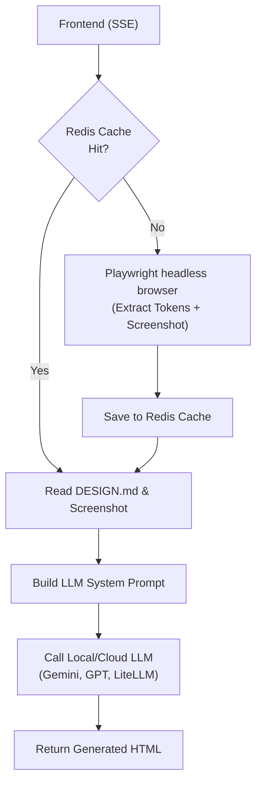

# 自動化 UI 視覺解析與 DESIGN.md 即時生成 — 實作總結

我們已經成功將自動化設計變數提取與 DESIGN.md 模板動態組裝機制整合到專案中。以下是本次開發的重要亮點與功能展示。

## 🎯 核心功能亮點

1. **AI 視覺設計爬蟲 (`design_extractor.py`)**：
   引入了 Playwright 啟動無頭瀏覽器，並向目標網頁注入 JavaScript 解析 `getComputedStyle`，提取出背景、字體、CTA 按鈕與卡片的視覺設計配置，並額外截取 base64 螢幕截圖。
   
2. **DESIGN.md 生成與 Fallback (`design_generator.py`)**：
   參考 Google Stitch 架構，將提取到的 Design Tokens 組裝成對 LLM 高度友好的 `DESIGN.md`。並設定了 15 秒超時的 Fallback 保護，確保 API 穩定性。

3. **設計快取機制 (`design_cache.py`)**：
   為避免重複爬取相同網域，實作了 Redis 快取（TTL: 24小時），加速後續同站點的頁面生成請求。

4. **SSE 分段進度回饋**：
   將 `trigger_page_api.py` 的生成端點替換為 `StreamingResponse`，前端 `CreateUrl.jsx` 透過 EventSource 收取即時進度狀態，配上 MUI Stepper 元件，大幅提升了 10~20 秒等待期間的使用者體驗。

---

## 🛠️ 架構變更概覽



### 變動檔案
- **後端新增**：
  - `adminapp/backend/services/design_extractor.py`
  - `adminapp/backend/services/design_generator.py`
  - `adminapp/backend/services/design_cache.py`
- **後端修改**：
  - `adminapp/backend/api/trigger_page_api.py` (新增 SSE 端點及重構 llm)
- **前端修改**：
  - `adminapp/frontend/src/app/views/qrcode/CreateUrl.jsx` (新增 Stepper UI 及 EventSource 接收器)
- **基礎設施**：
  - `adminapp/Dockerfile` (安裝 Chromium / Playwright 相依)
  - `adminapp/requirements.txt` (新增 `playwright`)
  - `nginx/nginx.conf` (關閉 `/api/trigger_page/generate_with_ai_stream` 的 Proxy Buffering)

---

## 🚀 驗證與後續操作

> [!WARNING]
> 本次修改動到了 Dockerfile（新增了 Playwright 和 Chromium 系統套件），因此**必須重新建構 Docker Image 才能生效。**

請在伺服器（或你的開發環境）執行以下指令來重建並啟動容器：

```bash
cd /home/mike/projects/fake_login
docker compose up -d --build
```

### 驗證步驟：
1. 重啟完成後，進入管理後台的「假網址生成」頁面。
2. 點擊 **AI 生成頁面**。
3. 填寫要模仿的 **參考網址**（例如 `https://accounts.google.com` 或 `https://login.microsoftonline.com`）及提示詞。
4. 點擊生成，觀察視窗中是否顯示分段進度條（解析目標網站 -> AI 生成頁面 -> 完成）。
5. 檢查最終產出的 HTML 是否套用了該網址的精準色系和圓角設定。
