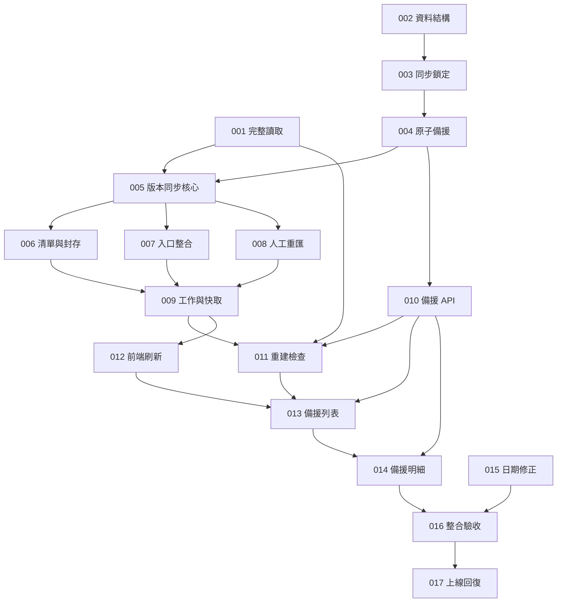

# 任務同步版本化與獨立備援區：總表與執行計畫

- 建立日期：2026-11-04。
- 文件狀態：已分票；TSB-001～014、TSB-015 已完成；尚未部署，現行DB未套用、admin-app 不在本次啟動範圍，其餘待開始。各功能完成情形以票單及驗證紀錄為準。
- 票號前綴：TSB（Task Sync and Backup），共 17 張。
- 目的：將單次大型修改拆成可交接、可驗收的小範圍工作，避免只修某個按鈕而漏掉其他同步入口。
- 本文件為需求與依賴的共同依據；各票記錄細部工作與驗收。需求變更時先更新總表，再更新受影響票。

## 1. 確認過的業務規則

1. 主系統任務刪除後重建時，`sendtask_uuid` 不變，`sendtask_create_ut` 會改變，寄送明細 `uuid` 會重新產生。
2. 主系統確認任務不存在時，Dashboard 不永久刪除資料，而是將完整舊版本搬入獨立備援區，移出現行任務列表。
3. 同 UUID、不同建立時間代表新版本。先取得完整新資料，再將舊版本備援並重新匯入；即使兩次同步之間沒觀察到刪除，也必須辨識重建。
4. 同一 UUID 可以有多份歷史備援，直到有權使用者自行刪除；不自動刪除已重建任務的備援。
5. 備援提供唯讀任務／受測者／觸發明細、本地 Excel 匯出、重建狀態檢查及永久刪除。
6. 備援查閱、匯出、檢查及刪除依備援當時的組織授權，不限於超級管理員。後端驗證可信任的登入者範圍，不能相信前端傳入的 org。
7. 備援是搬移當下已提交資料的固定快照；之後的舊郵件／QR Code 觸發不再追加備援，也不得污染新版本。
8. 一般同版本更新維持明細 UUID upsert，保留本地 `second_*` 觸發欄位。使用者確認只有整個任務刪除／重建，本次不做個別受測者差集刪除，也不按 email 去重。
9. 已累積重複資料的任務，提供「先備援，再重新匯入」修復，不能假設舊建立時間仍可用來辨識。
10. 本次不建置定時資料庫備份、不啟用原本關閉的排程、不改主系統 UUID，也不重設計整套 UI。

## 2. 為什麼 UUID 不會混淆

| 識別 | 用途 | 規則 |
| --- | --- | --- |
| `sendtask_uuid` | 現行任務與主系統 API | 現行表維持唯一，不加尾號 |
| 原始 UUID + 正規化建立時間 | 比較主系統版本 | 建立時間缺失／無效時不進行破壞性切換 |
| `local_generation_id` | Dashboard 目前資料版本 | 每次新匯入或人工重匯產生新值，避免同 UUID 跨版本污染 |
| `sync_revision` | 同一現行版本的同步修訂 | 用於拒絕過期的準備資料，不由主系統欄位覆寫 |
| `backup_id` | 備援列表、明細、匯出、刪除 | 每份備援唯一；所有備援 API 必須用此值 |
| `source_task_uuid` | 備援與主系統的來源關聯 | 可在多份備援重複，不能代替 `backup_id` 操作歷史版本 |

現行 API 不可在找不到現行任務時改查備援。備援 API 不可因找不到備援就改查同 UUID 的新版。

## 3. 目標狀態流程

| 遠端結果 | 現行資料 | 目標行為 |
| --- | --- | --- |
| 完整成功，同建立時間 | 存在 | 更新遠端擁有欄位與明細，保留本地觸發欄位 |
| 完整成功，不同建立時間 | 存在 | 原子備援舊版本、替換成乾淨的新版本 |
| 完整成功 | 不存在 | 匯入現行版本；可另外更新有權備援的重建觀測 |
| 確認任務不存在 | 存在 | 原子搬移到備援，不永久刪資料 |
| 確認任務不存在 | 不存在 | 不重複建立備援；更新觀測即可 |
| 查詢失敗、部分頁、無效建立時間 | 任意 | 保留原資料，回報錯誤或可重試狀態，不猜測重建 |
| 人工要求重新匯入，完整成功 | 存在 | 即使建立時間相同，也先備援再替換 |

「完整成功且合法 0 筆明細」與「讀取失敗」必須分開。HTTP 路徑 404、權限錯誤或登入頁不能不經判讀就當作任務已刪除。

## 4. 分票總表

所有票建立時均為「待開始」，下表持續更新實際狀態。工作量為相對分級，不是工期承諾：S 為單一局部行為，M 為跨數個相關函式，L 為多入口整合或資料一致性工作。

| 票號 | 工作項目 | 工作量 | 優先 | 前置票 | 初始狀態 |
| --- | --- | --- | --- | --- | --- |
| [TSB-001](01_TSB-001_主系統完整讀取契約.md) | 完整讀取、錯誤與不存在判斷 | M | P0 | 無 | 完成（2026-11-05，99ff222；入口已由007整合，未部署） |
| [TSB-002](02_TSB-002_版本與備援資料結構.md) | 現行版本識別、備援表與 migration | M | P0 | 無 | 完成（2026-11-05，297827f；現行DB未套用） |
| [TSB-003](03_TSB-003_同步鎖定與過期寫入防護.md) | 每任務鎖定、修訂與過期結果防護 | M | P0 | 002 | 完成（2026-11-05，85faf77；入口已由007整合，未部署） |
| [TSB-004](04_TSB-004_原子備援搬移.md) | 完整快照、原子搬移與事件邊界 | M | P0 | 002、003 | 完成（2026-11-05，801799d；入口已由007整合，未部署） |
| [TSB-005](05_TSB-005_版本同步核心.md) | 同版本更新與重建替換核心 | L | P0 | 001、003、004 | 完成（2026-11-05，61b7bb1；入口已由007整合，未部署） |
| [TSB-006](06_TSB-006_清單同步與封存政策.md) | 清單組織範圍、十四天封存與解除 | M | P0 | 005 | 完成（2026-11-09；清單服務已由007整合，未部署） |
| [TSB-007](07_TSB-007_全部同步入口整合.md) | 排程、按鈕、搜尋、啟動等入口統一 | L | P0 | 005 | 完成（2026-11-10；隔離測試通過，未部署） |
| [TSB-008](08_TSB-008_備援後重新匯入.md) | 既有重複資料修復後端工作 | M | P1 | 005 | 完成（2026-11-10；人工重匯與工作防重隔離驗收，未部署） |
| [TSB-009](09_TSB-009_工作結果與快取契約.md) | 狀態摘要、提交結果、快取版本隔離 | M | P0 | 006、007、008 | 完成（2026-11-11；逐筆成果、取消與版本快取驗收，未部署） |
| [TSB-010](10_TSB-010_備援查閱匯出與刪除API.md) | 備援資料 API、Excel 與組織授權 | L | P1 | 004 | 完成（2026-11-11；435項隔離回歸通過，未部署） |
| [TSB-011](11_TSB-011_備援重建檢查.md) | 重建標記、檢查工作及篩選 | M | P1 | 001、009、010 | 完成（2026-11-11；464項隔離回歸通過，未部署） |
| [TSB-012](12_TSB-012_前端刷新與修復操作.md) | 工作後刷新、正確移除舊列、重匯按鈕 | M | P0 | 009 | 完成（2026-11-12；Node、lint、build與隔離瀏覽器驗收，未部署） |
| [TSB-013](13_TSB-013_獨立備援列表.md) | 第三視圖、備援篩選與管理操作 | M | P1 | 010、011、012 | 完成（2026-11-18；實際隔離API與桌機／手機驗收，未部署） |
| [TSB-014](14_TSB-014_備援唯讀明細.md) | 舊版明細、匯出與資料來源隔離 | M | P1 | 010、013 | 完成（2026-11-18；來源隔離與真實備援API桌機／手機驗收，未部署） |
| [TSB-015](15_TSB-015_日期篩選與排序修正.md) | 秒／毫秒、台北日期、失敗篩選與排序 | S | P1 | 無 | 完成（2026-11-04，abc4d76） |
| [TSB-016](16_TSB-016_跨流程整合驗收.md) | 交易、並發、權限、事件與畫面整合驗收 | L | P0 | 001～015 | 待開始 |
| [TSB-017](17_TSB-017_上線與回復作業.md) | 單次備份還原檢查、切換與修復試點 | M | P0 | 016 | 待開始 |

P0 是資料安全與啟用門檻，P1 是完整功能；完整上線仍需所有票通過，不能因 P1 就省略備援查閱／匯出。

## 5. 建議執行順序

1. 第一批：001、002、015 可獨立進行；015 最適合先完成小範圍修正。
2. 第二批：003 → 004 → 005，建立資料一致性基礎。
3. 第三批：006、007、008、010 可在前置票完成後分別進行；006、007 會碰相同檔案，建議順序整合而非同時改同一區塊。
4. 第四批：009 → 012；009、010 完成後可做 011，再完成 013 → 014。
5. 第五批：016 全流程驗收，通過後才執行 017 正式切換。

圖僅呈現主要依賴；016 的正式前置仍為全部 001～015，不是只驗收 014、015。

## 6. 共用契約與分工邊界

### 6.1 資料與交易

- 備援標頭保留任務全欄位快照、當時統計及其基準時間、組織、原因、樣板 metadata；備援明細保留完整事件陣列，不只最後一筆。
- 歷史明細唯一鍵是 `(backup_id, uuid)`，不得要求原始明細 UUID 在全部備援版本中唯一。
- 同一個本地版本的搬移必須冪等；人工重新匯入可產生新的本地版本，即使主系統建立時間相同。
- 遠端資料在交易外準備；交易內鎖定、核對預期版本，再完成快照與替換。禁止使用各自 commit 的多個 CRUD 呼叫冒充單一交易。
- 已提交資料才發通知／使快取失效；外部通知或 Redis 故障不代表 PostgreSQL 已回滾。

### 6.2 同步入口

- 清單、今日建立、單筆／勾選、今日未完、每日同步、依名稱匯入、任務啟動、空表初始化及預熱都不能先覆寫建立時間。
- 已封存／超出新任務發現範圍，不代表可跳過版本辨識；「停止例行明細刷新」與「確認遠端是否重建」分開處理。
- 只有 TSB-005 決定版本更新與替換；TSB-006 決定清單範圍與封存；TSB-007 只整合其他入口，不再實作另一套重建邏輯。

### 6.3 備援權限與 UI

- `admin_role=True` 可全範圍；一般使用者需與備援快照組織有交集；空 org 拒絕；customer 不開放本次備援管理。
- 舊版與新版組織不同時，舊備援的權限不跟著新版改變。
- 備援 payload 唯讀；允許更新遠端檢查時間／重建觀測，或經授權永久刪除整份備援，不允許單獨清除其觸發紀錄。
- 重建已被證實後，後續查詢失敗不得改成未重建；最近遠端狀態與曾經重建的證據分開保存。
- 前端可以規劃資料來源介面，但不得以 mock 通過視為 API／權限驗收完成。

### 6.4 每票交付要求

1. 開工前重讀本總表、該票及前置票交付，不假設前一輪記憶仍正確。
2. 檢查工作目錄已有修改，保留使用者變更；只讀相關函式與測試，不重新大範圍探索。
3. 以該票最小範圍實作並同步增加聚焦測試；不是等 016 才補所有單元測試。
4. 更新該票狀態及總表，記錄實際修改、指令、結果、未通過項目和下游契約；無測試環境時標示「待驗收」，不可寫完成。
5. 票完成不等於可獨立部署。001～014 涉及共用資料路徑，需遵守下一節的啟用門檻。

## 7. 啟用門檻與回復限制

- 015 可獨立驗收／部署，不能藉此變更其他同步行為。
- 002 的 additive migration 可先準備，但不允許自動搬移正式資料；實際執行須有備份及相容性驗證。
- 003～005 可先在測試環境完成共用服務，但正式寫入必須等 006、007、009 全部接通，避免舊入口繼續永久刪資料或先覆寫建立時間。
- 正式備援搬移還需要 010～014 可查閱、管理及正確刷新；不可先把資料搬走，卻沒有查閱方式。
- 正式切換由 017 執行。停止舊同步／預熱與事件寫入後，才進行一致的版本升級；保留原排程開關，不擅自啟用。
- 備援有資料後，不可直接回退成不認識備援表的舊程式。回復需停止寫入、評估資料搬移，必要時用已驗證的完整備份還原。

## 8. 總體驗收情境

| 情境 | 必須成立 |
| --- | --- |
| 舊版 3 人，主系統刪除 | 現行移出、備援仍有 3 人及原觸發紀錄 |
| 同 UUID 新版 5 人 | 現行只有新 5 人，不混入舊 3 人；備援仍可查 |
| 同步未觀察到 404，只看到建立時間變更 | 仍備援舊版並乾淨匯入新版 |
| 已有重複明細，建立時間已被覆寫 | 人工先備援再重匯可以修復 |
| 分頁中斷、500、無效版本、寫入中斷 | 舊資料保留，不宣稱成功、不產生半份備援 |
| 同 UUID 同時排程／手動更新 | 不多搬、不將過期結果覆蓋新版本 |
| 同 org、跨 org、空 org、customer | 每條列表／明細／匯出／檢查／刪除路徑都遵守範圍 |
| 刪除某份備援 | 現行任務與其他備援完全不受影響 |
| 晚到舊明細事件 | 不再寫備援，也不寫到新版 |
| 搬移、重建、部分完成、取消後已有提交 | 畫面正確刷新，不留下不存在的現行列 |
| 台北午夜與非台北瀏覽器時區 | 今日邊界一致；明天／下週任務不誤列執行中 |

## 9. 備份現況與排除範圍

截至本輪調查，Compose 僅掛載 `./pg_backup:/backup`，資料夾為空；專案內及可讀系統排程未發現已配置的資料庫定時備份。私人 crontab 無權讀取，不能完全排除其他主機／儲存層備份，因此結論是「尚無已驗證的自動備份」。

本專案的備援表與現行資料都在同一個 PostgreSQL；磁碟／資料庫損毀時仍可能一起遺失。本次不建置每日備份、異機備份、歷史版本持續收事件、email 去重或個別受測者刪除同步。正式變更前的一次人工完整備份與還原演練是上線門檻，不是新增定時備份功能。

已經被舊程式永久刪除、且無外部備份的資料，無法靠此方案復原。

## 10. 交接使用方式

可以逐票交辦，例如：「先實作 TSB-015」或「完成 TSB-001，先不要處理下一票」。執行者應先看本總表，再看單票文件。

建議狀態順序：待開始 → 進行中 → 待驗收 → 完成；遇到阻礙改標「受阻」並記錄原因。若核心票仍過大，可以拆成子票，但必須同步維護總表、依賴與未完成驗收，不可省略原要求。