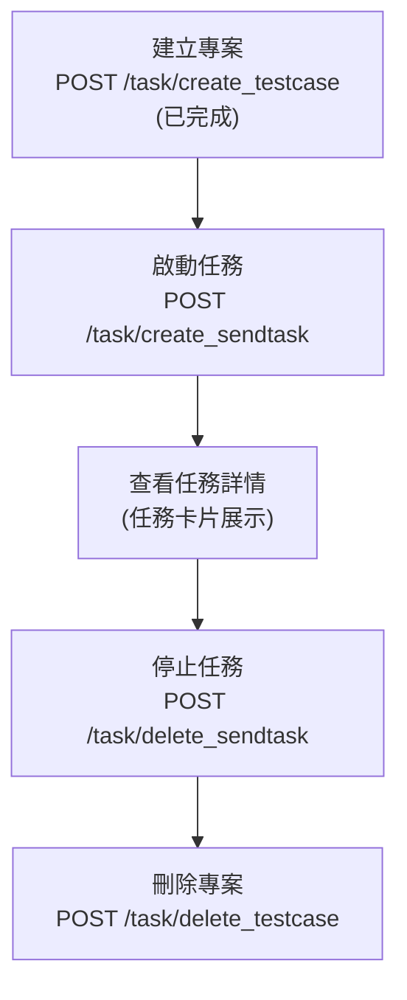

# 任務管理 UI — 啟動 / 停止 / 刪除 + 任務列表

## 背景

目前 `CreateTask.jsx` 可以建立專案（testcase），後端 `create_task_api.py` 已有 4 個端點就緒。本次需要：

1. **Customer.jsx**：讓客戶可以「啟動任務」、「停止任務」、「刪除專案」，並查看建立後的任務詳細資料
2. **CustomersPanel.jsx**：讓管理員可以在客戶列表中，查看每位客戶所建立的專案與啟動的任務

## 業務流程



## Proposed Changes

---

### 1. 後端：新增查詢客戶專案列表 API

#### [NEW] `GET /api/task/get_customer_tasks` 端點

> [!IMPORTANT]
> 需要一個方法讓前端知道某個客戶建立了哪些專案（testcase）以及哪些已啟動為任務（sendtask）。
> 
> **方案 A**：在 SE2 中有現成 API 可以查詢某 `unit_uuid` 下的所有 testcase/sendtask  
> **方案 B**：在自家 DB 中新增一張表 `customer_tasks` 記錄每次建立的 testcase_uuid 與狀態
> 
> 建議使用 **方案 B**，因為需要追蹤「是這個客戶建立的」這個關聯資訊。

#### [MODIFY] [create_task_api.py](file:///home/mike/projects/fake_login/adminapp/backend/api/create_task_api.py)

在 `create_testcase` 成功後，將專案記錄存入 DB：
- `acct_uuid`（客戶 UUID）
- `testcase_uuid`
- `task_name`
- `task_type`
- `status`：`created` → `active` → `stopped` → `deleted`
- `created_at`

在 `create_sendtask`、`delete_sendtask`、`delete_testcase` 成功後，更新 DB 中對應記錄的 `status`。

#### [NEW] DB Model `CustomerTask`

在 [models.py](file:///home/mike/projects/fake_login/adminapp/backend/repository/models.py) 新增：

```python
class CustomerTask(Base):
    __tablename__ = 'customer_tasks'
    id = Column(Integer, primary_key=True, autoincrement=True)
    acct_uuid = Column(String(36), nullable=False)       # 客戶 UUID
    testcase_uuid = Column(String(36), unique=True)      # 專案 UUID
    sendtask_uuid = Column(String(36), nullable=True)    # 任務 UUID (啟動後才有)
    task_name = Column(String(255))                       # 任務名稱
    task_type = Column(String(20))                        # pre / official
    status = Column(String(20), default='created')        # created / active / stopped / deleted
    created_at = Column(DateTime, server_default=func.now())
```

#### [NEW] `GET /api/task/get_customer_tasks?acct_uuid=...`

回傳指定客戶的所有專案/任務記錄，供前端顯示。

---

### 2. 前端：Customer.jsx 修改

#### [MODIFY] [Customer.jsx](file:///home/mike/projects/fake_login/adminapp/frontend/src/app/views/customer/Customer.jsx)

**建立成功後的流程改善：**
- `CreateTask` 建立成功後，回傳 `testcase_uuid`，在 Customer.jsx 中新增一張「我的專案」區塊（表格或卡片列表）
- 從 `GET /api/task/get_customer_tasks` 取得目前客戶所有的專案記錄

**新增操作按鈕（每個專案卡片上）：**

| 按鈕 | 顯示條件 | 呼叫 API | 說明 |
|------|---------|---------|------|
| 🚀 啟動任務 | `status === 'created'` | `POST /api/task/create_sendtask` | 將專案啟動為寄送任務 |
| ⏹ 停止任務 | `status === 'active'` | `POST /api/task/delete_sendtask` | 停止正在執行的任務 |
| 🗑 刪除專案 | `status === 'created'` 或 `status === 'stopped'` | `POST /api/task/delete_testcase` | 刪除專案 |

**任務詳細資料展示：**
- 當 `status === 'active'` 時，可透過現有的 `sendtask_uuid` 呼叫 `/api/customer_get_sendtasks` + `/api/get_sendlog_stats` 取得寄送統計
- 在專案卡片下方展示：總信件數、已寄出、已觸發等統計資訊

---

### 3. 前端：CustomersPanel.jsx 修改

#### [MODIFY] [CustomersPanel.jsx](file:///home/mike/projects/fake_login/adminapp/frontend/src/app/views/customers/CustomersPanel.jsx)

在每個客戶的 Accordion 展開區塊中，新增一個「客戶建立的專案/任務」列表：

- 呼叫 `GET /api/task/get_customer_tasks?acct_uuid=<acct_uuid>` 取得該客戶的所有專案
- 以表格形式展示：

| 欄位 | 說明 |
|------|------|
| 專案名稱 | `task_name` |
| 類型 | 前測 / 正式 |
| 狀態 | Chip 標籤：已建立(藍) / 執行中(綠) / 已停止(橙) / 已刪除(灰) |
| 建立時間 | `created_at` |
| 操作 | 管理員可代為「停止任務」或「刪除專案」 |

---

### 4. 前端：CreateTask.jsx 修改

#### [MODIFY] [CreateTask.jsx](file:///home/mike/projects/fake_login/adminapp/frontend/src/app/views/customer/CreateTask.jsx)

- 建立成功後，呼叫 `onSuccess(testcase_uuid)` 回傳 UUID 給父元件
- 父元件收到後重新整理「我的專案」列表

---

## 修改摘要

| 檔案 | 動作 | 說明 |
|------|------|------|
| `models.py` | 新增 | `CustomerTask` 資料表 |
| `create_task_api.py` | 修改 | 各端點成功後寫入/更新 DB，新增查詢端點 |
| `Customer.jsx` | 修改 | 新增「我的專案」區塊 + 操作按鈕 + 任務詳情 |
| `CustomersPanel.jsx` | 修改 | 在客戶展開區新增專案/任務列表 |
| `CreateTask.jsx` | 修改 | 建立成功後回傳 UUID |

## Open Questions

> [!IMPORTANT]
> **資料追蹤方式**：計畫採用在自家 DB 新增 `customer_tasks` 表來追蹤客戶建立的專案。這樣每次建立/啟動/停止/刪除都會更新這張表。您同意這個方式嗎？或者 SE2 有現成的 API 可以查詢特定組織下的 testcase 列表？

> [!NOTE]
> **管理員權限**：CustomersPanel.jsx 中的「停止任務」和「刪除專案」按鈕，是否需要額外的權限檢查？目前假設管理員可以直接操作。

## 驗證計畫

### 手動驗證
1. 客戶端：建立專案 → 啟動任務 → 查看統計 → 停止任務 → 刪除專案，全流程測試
2. 管理端：開啟客戶 Accordion → 確認可看到該客戶的專案列表 → 代為操作停止/刪除
